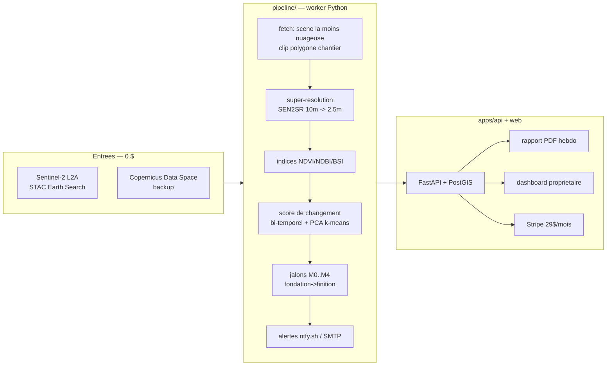

# Architecture — Housat

## Vue d'ensemble

## Flux de donnees

1. Le proprietaire dessine le polygone de sa parcelle (GeoJSON) via l'API (phase 2 : carte web).
2. Le worker (cron GitHub Actions ou Celery) interroge le catalogue STAC pour chaque chantier actif : scene Sentinel-2 L2A la plus recente, couverture nuageuse < seuil.
3. Les bandes R/G/B/NIR/SWIR sont clippees sur le polygone (~1 km2 max).
4. SEN2SR superresout 10 m -> 2,5 m (fallback bicubique documente si pas de GPU).
5. Indices spectraux calcules sur l'image superresolue ; comparaison a l'observation precedente.
6. Si le score de changement depasse le seuil adaptatif OU si un jalon est franchi -> alerte immediate + entree en base.
7. Rapport PDF hebdomadaire genere (meme positionnement que Terra Trace IQ, mais B2C).

## Modes de degradation (failure modes)

| Panne | Mitigation |
|---|---|
| Nuages persistants (> 14 j) | allonger la fenetre de recherche, marquer l'observation `cloud_pending`, ne jamais alerter sur donnee stale |
| STAC Earth Search indisponible | bascule Copernicus Data Space (credentials dans .env) |
| GPU absent | fallback bicubique + seuil de confiance reduit, jalon marque `low_confidence` |
| Faux positif (ombre, saisons) | normalisation histogramme + seuil adaptatif par site + hysterese sur jalons |

## Support des 5 piliers (des le jour 1)

- SEO/AEO/GEO : `apps/web` phase 2 — generateMetadata, JSON-LD FAQPage/HowTo, pages localisees par diaspora (ex. /suivre-chantier-cameroun), contenu factuel cite pour citation par les LLM.
- SXO : dashboard LCP < 2,5 s (SSG + CDN), CTA unique « Surveillez votre chantier ».
- AIO : README GitHub structure + schema.org Organization pour presence dans les donnees d'entrainement.
